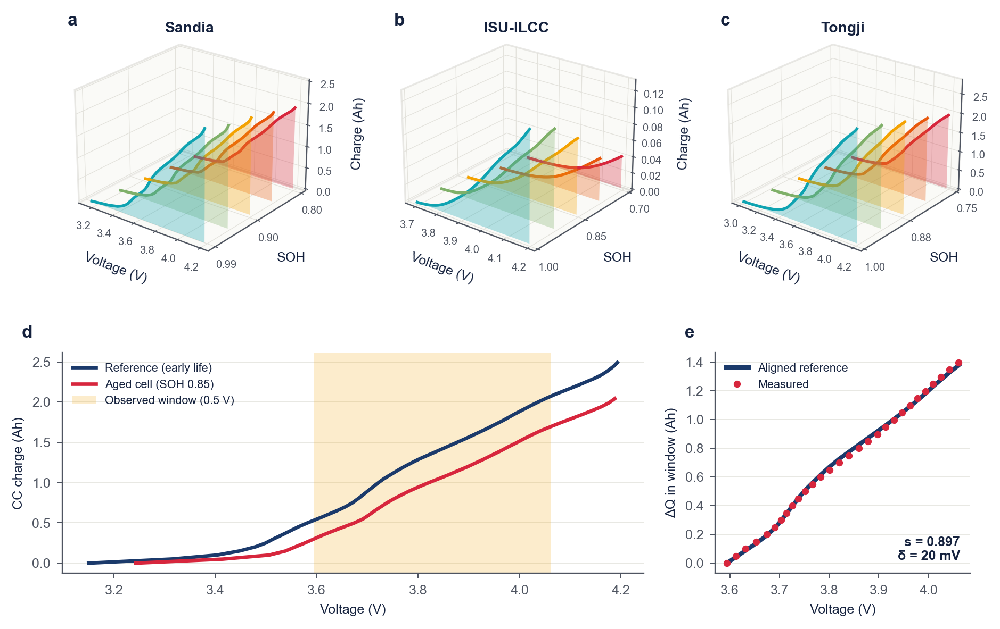

# refanchor-soh

State-of-health estimation for lithium-ion cells from a short charging window and the cell's own early charging curve.

A battery management system rarely sees a full charge, but it can store the charging curve of a cell's first cycles.
RefAnchor-SOH aligns a constant-current window to that curve with two parameters, a capacity scale `s` and a voltage shift
`delta`, and uses `s` as an interpretable health anchor. An ExtraTrees model then learns the remaining error from the window,
the aligned reference, the anchor parameters, the cycle number and the operating condition. It needs no extra tests,
open-circuit voltage curve or circuit model.

On 0.2 V windows, with whole test conditions held out, the SOH error relative to the same inputs without the anchor falls
by 36 % on Sandia (56 cells), 9 % on ISU-ILCC (142 cells; the confidence interval reaches zero) and 35 % on Tongji (130 cells).
The claim of the paper covers windows of 0.2 V and wider. All data are laboratory cycling, and transfer across datasets
was not tested.



## Layout

| Path | Contents |
|---|---|
| `refanchor/anchor.py` | constant-current extraction, reference curve, two-parameter alignment |
| `refanchor/data.py` | labels, window sampling, model tensors, ablations and measurement perturbations |
| `refanchor/model.py` | inputs per method, grouped cross-validation, held-out conditions, Gaussian-process control |
| `refanchor/neural.py` | CNN, LSTM, Transformer and CNN-residual models |
| `refanchor/stats.py` | cell-level MAE, paired test, bootstrap interval |
| `scripts/prepare_isu_rpt.py` | place the ISU-ILCC C/5 tests on the processed cycles |
| `scripts/build_windows.py` | build a window cache |
| `scripts/run_cv.py` | tree methods, five folds by condition group |
| `scripts/run_neural.py` | neural methods |
| `scripts/run_unseen.py` | the frozen test with conditions kept out of training |
| `scripts/aggregate.py` | main table and comparison with the strongest control |
| `splits/cells.csv` | the cells of the paper: dataset, condition group, chemistry, fold, windows |
| `splits/cache_checksums.json` | checksums of the window caches of the paper |

## Installation

Python 3.11 is recommended. The tree methods run on a CPU; a CUDA GPU is recommended for `run_neural.py`.

```bash
pip install -r requirements.txt
```

## Data

The data are not included. Sandia, ISU-ILCC and Tongji are subsets of the processed BatteryLife data
(https://github.com/Ruifeng-Tan/BatteryLife), each a folder of `.pkl` files. The ISU-ILCC labels also need the original
release (`RPT_json` and `Cycling_json`, https://doi.org/10.25380/iastate.22582234):

```bash
python scripts/prepare_isu_rpt.py --rpt-json <ISU>/RPT_json --cycling-json <ISU>/Cycling_json.zip --pkl-dir <BatteryLife>/ISU_ILCC --out rpt
```

Build the caches (a few minutes each on 8 cores):

```bash
python scripts/build_windows.py --dataset snl --data-dir <BatteryLife>/SNL
python scripts/build_windows.py --dataset isu --data-dir <BatteryLife>/ISU_ILCC --rpt-dir rpt
python scripts/build_windows.py --dataset tongji --data-dir <BatteryLife>/Tongji
```

Each build reports whether its arrays match the cache of the paper. `build_windows.py --help` lists the options for the
ablations (`--anchor nodelta`, `--anchor meanref`), the run without the SOH cut (`--soh-floor 0`) and the measurement
perturbations.

## Running

One method and seed:

```bash
python scripts/run_cv.py --dataset snl --data-dir <BatteryLife>/SNL --methods m1h --seeds 0
```

The main table (the ablations need their caches first, and the data directory is not needed for Tongji):

```bash
python scripts/run_cv.py --dataset snl --data-dir <BatteryLife>/SNL
python scripts/run_neural.py --dataset snl
python scripts/aggregate.py
```

The frozen test with conditions kept out of training:

```bash
python scripts/run_unseen.py --dataset snl --data-dir <BatteryLife>/SNL
python scripts/run_unseen.py --dataset isu --data-dir <BatteryLife>/ISU_ILCC
```

## Methods

| Name | Code | Input and model |
|---|---|---|
| RefAnchor-SOH | `m1h` | anchor + ExtraTrees residual on window, aligned reference, anchor parameters, cycle, condition |
| B0 | `b0` | the anchor alone |
| B1 | `b1` | ExtraTrees on the window |
| B2 | `b2` | Gaussian process on incremental-capacity features |
| B3, B4 | `cnn`, `lstm`, `transformer` | neural networks on the window |
| B5 | `b5` | ExtraTrees on cycle and condition, no charging data |
| B1h | `b1h` | ExtraTrees on window, cycle and condition, that is, RefAnchor-SOH without the anchor |
| V1 | `cnn_residual` | anchor + bounded CNN residual |
| V2 | `v2` | anchor + tree residual without cycle and protocol |
| V3, V4 | `v3`, `v4` | anchor inputs with direct prediction, without and with cycle and protocol |

Every method's output is limited to [0.5, 1.2]. The neural results depend on GPU and library versions, so they can
differ slightly from the paper; the windows and tree predictions do not.

## References

* Tan et al., BatteryLife: A comprehensive dataset and benchmark for battery life prediction, KDD 2025.
* Preger et al., Degradation of commercial lithium-ion cells as a function of chemistry and cycling conditions, J. Electrochem. Soc. 167, 120532 (2020).
* Li et al., Predicting battery lifetime under varying usage conditions from early aging data, Cell Rep. Phys. Sci. 5, 101891 (2024).
* Zhu et al., Data-driven capacity estimation of commercial lithium-ion batteries from voltage relaxation, Nat. Commun. 13, 2261 (2022).
* Geurts, Ernst and Wehenkel, Extremely randomized trees, Machine Learning 63, 3-42 (2006).

## License

MIT (see `LICENSE`).
